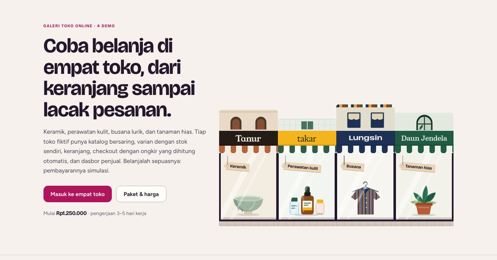

# PortalToko — Jalan Pertokoan

Galeri demo toko online PintuWeb: keramik, perawatan kulit, busana lurik, dan tanaman hias. Tiap toko bisa dicoba belanja sampai lacak pesanan; pembayarannya simulasi.

**Demo live:** https://www.pintuweb.id/toko-online



> Katalog demo milik PintuWeb. Semua usaha di demo fiktif.

## Konsep

Deretan ruko di satu jalan. Pahlawan memuat empat ruko berdempetan dengan lantai atas yang tingginya berbeda, papan nama memakai huruf dan warna merek tiap toko, kanopi bergaris bertepi gelombang, kaca etalase berpantulan, dan label harga gantung berisi kategorinya. Galeri memakai papan nama dan kanopi yang sama di atas potret ponsel asli tiap toko. Alur belanja dan paket harga ditulis di label karton kraft yang tergantung di rel.

## Toko yang dipamerkan (4)

- [Tanur](https://toko-tanur.pintuweb.id) — keramik buatan tangan; pemilih glasir dari ubin uji, stok per glasir × ukuran
- [Takar](https://toko-takar.pintuweb.id) — perawatan kulit; penemu produk, penyusun rutinitas, kamus kandungan, isi ulang
- [Lungsin](https://toko-lungsin.pintuweb.id) — pakaian lurik; Ukuranku, padu-padan, lookbook, tukar ukuran
- [Daun Jendela](https://toko-daunjendela.pintuweb.id) — tanaman hias; cari menurut cahaya, padanan pot, kalender rawat

Potret ponsel tiap toko ada di `public/images/toko/<slug>.webp` (390×844, dipotret dari halaman live dengan `scripts/potret.mjs`); varian WebP-nya dibuat `node scripts/static-images.mjs . --base /toko-online`.

## Halaman

`/` (tayang sebagai `/toko-online` di domain utama lewat basePath + rewrite PintuWeb) dan 404 bergaya. Akar dan path lain di portal-toko.pintuweb.id dialihkan 308 ke https://www.pintuweb.id/toko-online.

## Teknologi

- Next.js 15.5 (App Router) dan React 19, JavaScript
- Tailwind CSS v4
- Font: Bricolage Grotesque, Figtree (next/font). Nama merek keempat toko berupa path SVG dari huruf aslinya (Young Serif, Hedvig Letters Serif, Anybody, Besley; semuanya OFL), jadi tidak ada font tambahan yang dimuat.
- SEO: metadata, Open Graph, JSON-LD CollectionPage + ItemList + BreadcrumbList + FAQPage

Angka paket diambil dari `app/components/pintuweb.js` (PAKET: Toko Online Simple dan Toko Online Full di PintuWeb/app/lib/packages.ts). Kalau harga di sana berubah, ubah juga di sini.

## Menjalankan secara lokal

```bash
npm install
npm run dev
```

Buka http://localhost:3000/toko-online. Untuk build produksi: `npm run build` lalu `npm start`.

---

Dibuat oleh [PintuWeb](https://www.pintuweb.id), jasa pembuatan website.
